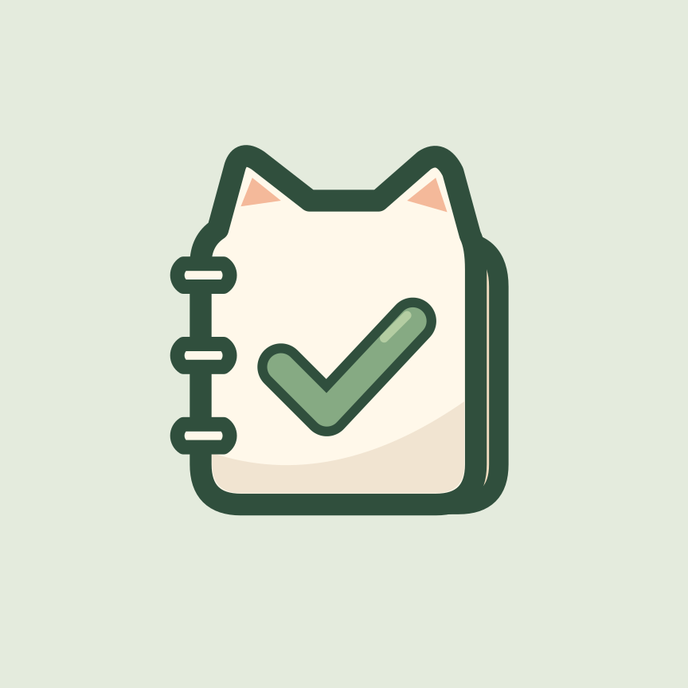
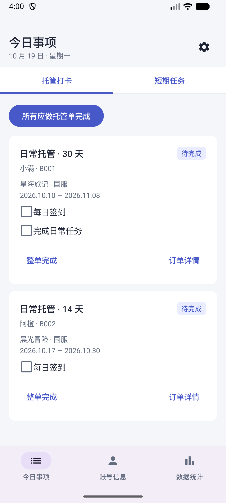
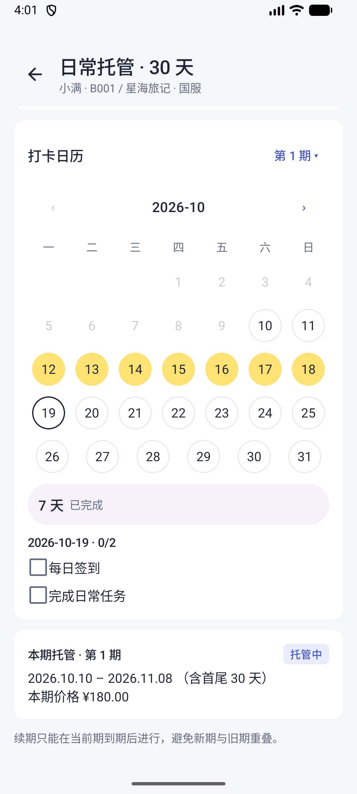
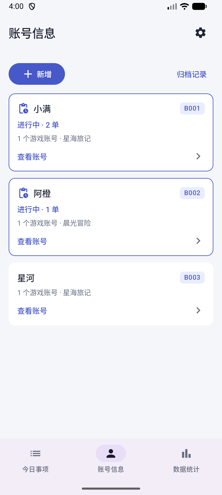
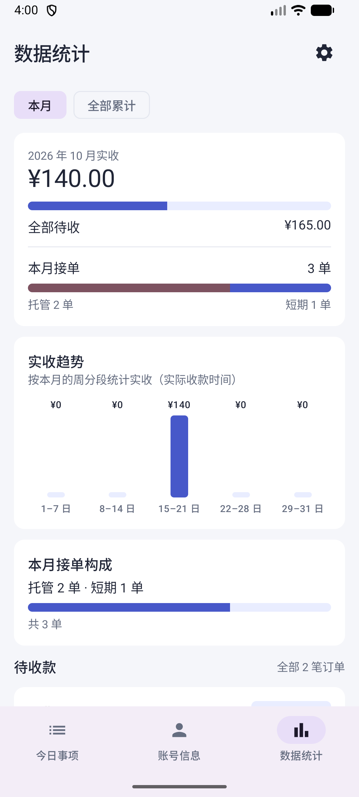
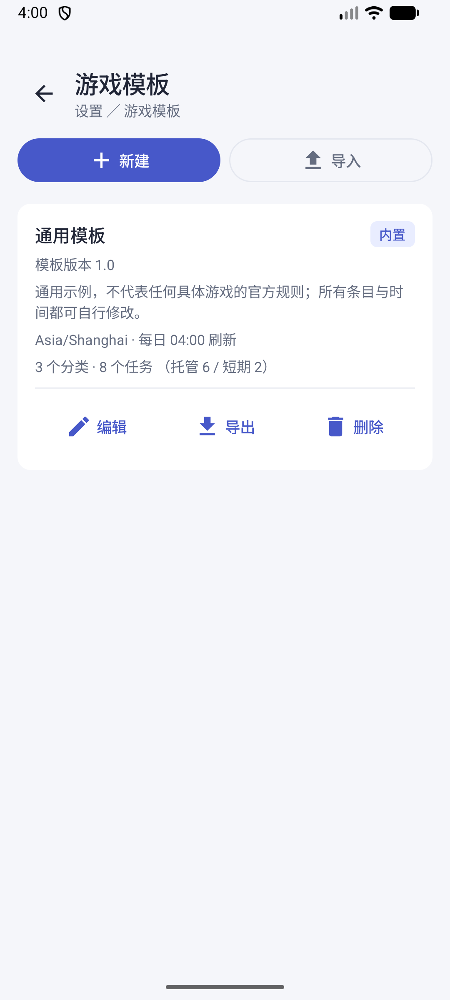
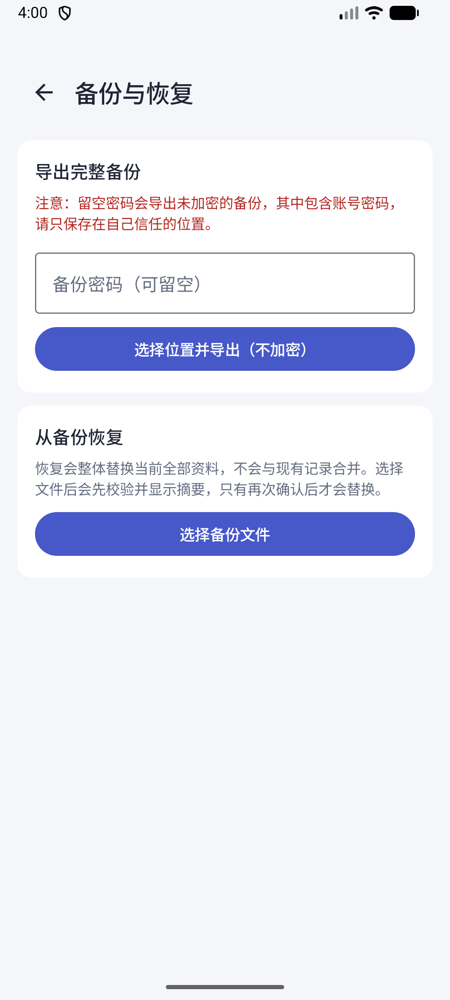

<p align="center">
  
</p>

<h1 align="center">代肝记录</h1>

<p align="center">把老板、订单、每日打卡和收款，放进同一本小账本。</p>
<p align="center"><strong>v1.6 Beta · Android 8.0+ · 离线使用 · 中文界面</strong></p>

接的单多了，最容易混在一起的往往是这些事：今天该上哪个号、这单做到哪一天、老板付了多少、还有哪笔钱没收齐。

**代肝记录**是一款为个人游戏代肝接单者制作的 Android 记录工具。把老板和账号建好，再把托管、短期任务和收款记进去，就可以从「今日事项」「账号信息」「数据统计」三个入口查看。

游戏操作由使用者自行完成，应用负责记录任务、服务进度和账目。v1.6 修复了订单纠错、误建订单清理和归档展示问题，并新增每月固定日期任务。安装包见 Releases。

## 先看看实际界面

以下截图来自 **v1.5 的真实界面**，使用虚构的老板、游戏、账号和订单演示，不包含真实客户资料。

<table>
  <tr>
    <td align="center"><strong>今天要做什么</strong><br><br>按订单处理当天任务</td>
    <td align="center"><strong>托管做到哪一天</strong><br><br>完成一天，日历亮起一天</td>
    <td align="center"><strong>谁还有单在做</strong><br><br>进行中的老板自动置顶</td>
  </tr>
</table>

## 它能帮你记什么

| 你想知道 | 在哪里看、怎么记 |
|---|---|
| 今天还有哪些号没做？ | 「今日事项」查看托管打卡或短期任务，逐项完成，也支持批量完成与撤销。 |
| 这位老板有哪些账号和订单？ | 「账号信息」按老板管理游戏账号、区服和登录资料；有进行中订单时自动标记、置顶。 |
| 托管已经做了多少天？ | 订单详情的日历显示打卡状态，可选择历史日期补打卡或更正。 |
| 老板续了下一期，旧记录怎么办？ | 到期后续期，原期次的价格、打卡和收款记录继续保留。 |
| 这单究竟还欠多少钱？ | 记录约定价格和每笔实际收款，支持分次收款，分别查看实收和待收。 |
| 每次建单都要重新填任务吗？ | 可用通用模板预填；按自己的业务编辑，也可以导入、导出模板文件。 |
| 怕忘记任务，或者换手机怎么办？ | 在设置中开启业务提醒、导出完整备份，必要时用备份恢复资料。 |

<table>
  <tr>
    <td align="center"><strong>实收和待收分开看</strong><br></td>
    <td align="center"><strong>按自己的业务配模板</strong><br></td>
    <td align="center"><strong>把资料备份好</strong><br></td>
  </tr>
</table>

## v1.6 更新

订单详情支持修改服务日期，以及删除无业务记录的误建订单或作废已有记录的订单；已归档账号默认折叠。任务和模板支持每月固定 1–31 号更新，当月没有该日则跳过。已有打卡、截图及收款受到保留规则保护。

安装包可从下方 Releases 下载，问题及验证见 [v1.6 修复记录](docs/handoffs/v1.6-user-feedback.md)。

## 下载与安装

- 系统要求：Android 8.0 / API 26 及以上。目前提供 Android 版本。
- 下载位置：本仓库的 **[Releases](https://github.com/undefinedfrancis/daigan-record/releases)** 页面，选择最新 Beta，在 **Assets** 中下载 `.apk` 文件；`Source code` 是源码压缩包。
- 当前公开下载版本：**[v1.6 Beta 1](https://github.com/undefinedfrancis/daigan-record/releases/tag/v1.6-beta.1)**。
- **[直接下载 Android 安装包（APK）](https://github.com/undefinedfrancis/daigan-record/releases/download/v1.6-beta.1/daigan-record-v1.6-debug.apk)** · [SHA-256 校验文件](https://github.com/undefinedfrancis/daigan-record/releases/download/v1.6-beta.1/SHA256SUMS)
- 安装：在手机上打开 APK，按系统提示允许该下载来源安装应用。升级前先在应用内备份资料，尽量使用同一发布渠道的安装包覆盖升级。

当前安装包使用调试签名。后续若调整分发签名，会在 Release 说明中告知安装和迁移方式。

## 第一次用，按这五步来

### 1. 新增老板，再添加游戏账号

打开 **账号信息 → 新增**，填写老板昵称。进入老板详情，添加游戏、区服、UID 和登录方式。

一位老板可以有多个游戏账号。后续建单、查资料和看记录，都从这里找到对应的人和账号。

### 2. 在账号下新建订单

按工作内容选择：

- 托管单：适合连续多天的日常服务，填写开始和结束日期、本期价格、任务、时区及每日刷新时间。
- 短期单：适合活动、关卡等一次性委托，填写任务、约定价格和截止日期。

可以先选通用模板再调整任务，也可以自行填写。时区默认提供中国时间和美国东部纽约时间，支持自行增删；纽约时区会处理夏令时，实际选择以对应游戏区服为准。

### 3. 每天处理「今日事项」

做完一项任务就勾选一项。托管和短期任务分别查看；需要时使用批量完成或撤销。

进入订单详情可以查看打卡日历。漏记时，选择过去的服务日期，再勾选对应任务补打卡。批量完成处理当前应做任务，历史遗漏需要单独补录。

### 4. 收到钱，再记录实收

在订单的收款区域记录实际收到的金额，分次付款就分次记。

例如，一张约定 **180 元**的托管单，先收到 **60 元**，还应收 **120 元**。约定价格和实际收款分别记录，方便核对。

「数据统计」可查看本月或累计实收，以及全部待收款。短期单结单后，或托管服务到期后，老板名下没有其他进行中的订单，就会自动取消置顶。

### 5. 按需开启提醒，定期备份

进入 **设置 → 提醒设置**，开启需要的提醒并设置时间，按手机提示允许通知。

进入 **设置 → 备份与恢复** 导出资料，可以选择密码加密。恢复备份会替换现有资料，请先备份当前记录；加密备份的密码需要自行妥善保存。

## 关于本地数据与 Beta

- 资料保存在手机本地，应用不申请网络权限；目前没有云端同步或多人协作。
- 完整备份可带走业务资料与附件。模板 JSON 只交换任务模板，不是业务资料备份。
- 本地保存不等于本机数据库已加密；备份文件可选密码加密，请自行管理手机和文件的访问权限。
- 目前主要在 Android 模拟器上验证，实体机兼容性仍需要更多用户帮助测试。建议先用少量演示记录熟悉流程，再逐步投入实际使用。

## 开发与项目资料

使用 Kotlin、Jetpack Compose、Room、Hilt 和 WorkManager。开发环境为 JDK 21、Android SDK 36，使用仓库自带的 Gradle Wrapper。

```sh
./gradlew :app:testDebugUnitTest :app:lintDebug :app:assembleDebug
# 连接设备或模拟器后：
./gradlew :app:connectedDebugAndroidTest
```

调试包输出在 `app/build/outputs/apk/debug/app-debug.apk`。本机 SDK 路径通过 `local.properties` 或 Android Studio 配置，构建说明见 [贡献约定](CONTRIBUTING.md)。

- [版本记录](CHANGELOG.md)
- [文档索引](docs/README.md)
- [测试与验收](docs/testing.md)
- [Beta 发布准备](docs/beta-release.md)
- [图标设计与来源](docs/design/app-icon/README.md)

## 来源与许可

源码底座来自 Google `android/architecture-templates`，遵循 [Apache License 2.0](LICENSE)。派生文件保留版权声明，详见 [上游来源记录](docs/upstream-foundation.md)。
